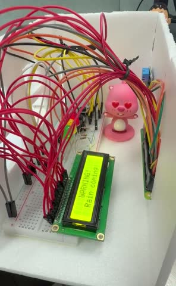

# Planty · 스마트 반려식물 모니터링

호서대학교 4-1 실험 텀프로젝트 자료를 바탕으로 정리한 라즈베리파이 기반 식물 환경 모니터링 코드입니다. DHT11 센서로 온도와 습도를 읽고, 식물별 적정 범위와 비교해 LED·LCD·부저로 상태를 알립니다. 두 버튼으로 식물 프로필을 변경하며, OpenWeatherMap의 현재 날씨와 약 3시간 뒤 예보를 조회해 악천후 또는 온도 경보를 표시합니다.

## 동작 흐름

1. DHT11에서 온도·습도를 읽습니다. 읽기 오류가 나면 마지막으로 성공한 값을 사용합니다.
2. 선택한 프로필의 온도·습도 범위와 비교합니다. 둘 다 범위 안이면 `happy`, 하나만 범위 안이면 `soso`, 둘 다 벗어나면 `help`입니다.
3. 초록·노랑·빨강 LED와 16×2 LCD에 상태를 표시합니다. `help`로 처음 전환되면 LED·LCD·부저 경보를 실행합니다.
4. MOVE·CONFIRM 버튼으로 다육이·관엽식물·허브 프로필을 탐색하고 확정합니다.
5. 날씨 API에서 현재 날씨와 약 3시간 뒤 예보를 받아 강수·눈·뇌우 또는 프로필 온도 범위 이탈을 확인합니다.

| 프로필 | 온도 범위 | 습도 범위 |
| --- | --- | --- |
| 다육이 | 15–30°C | 30–50% |
| 관엽식물 | 18–28°C | 50–70% |
| 허브 | 15–25°C | 40–60% |

## 코드 구성

| 파일 | 역할 |
| --- | --- |
| `src/main.py` | 센서·버튼·날씨 처리와 상태 판정 |
| `src/sensors.py` | DHT11 측정과 버튼 입력 |
| `src/actuators.py` | LED·부저·8비트 LCD 제어 |
| `src/weather.py` | 현재 날씨·예보 조회와 경보 판단 |
| `src/display_manager.py` | 평상시·선택·프로필 변경·경보 화면 상태 관리 |
| `src/config.py` | BCM 핀 번호, 식물별 기준, 갱신 주기 |
| `src/gpio_handle.py` | 여러 모듈에서 공유하는 lgpio 핸들 |

## 시연 영상

아래 이미지를 누르면 다운로드 없이 재생할 수 있는 시연 페이지가 열립니다. 두 영상 모두 실제 장치의 LCD와 배선 상태를 보여줍니다.

**식물 프로필 선택** · 약 12초. 버튼 조작에 따라 LCD에 `Select Plant?`와 식물 이름이 표시됩니다.

<a href="https://seojeejee.github.io/planty-smart-plant-monitor/#profile"></a>

[프로필 선택 영상 재생](https://seojeejee.github.io/planty-smart-plant-monitor/#profile)

**기상 경보 화면** · 약 10초. LCD에 `WARNING!`과 강수 경고 문구가 표시됩니다. 영상만으로 예보 API의 호출 경로나 경보 발생 조건까지 검증할 수는 없습니다.

<a href="https://seojeejee.github.io/planty-smart-plant-monitor/#alert"></a>

[경보 화면 영상 재생](https://seojeejee.github.io/planty-smart-plant-monitor/#alert)

## 실행 환경

라즈베리파이, DHT11, 버튼 2개, LED 3개, 부저, 16×2 LCD의 BCM 배선을 `src/config.py`에 맞춰 연결해야 합니다. Python 패키지는 `requirements.txt`에 정리했습니다. 라즈베리파이 OS와 보드에 따라 GPIO 접근 권한 및 시스템 패키지 설정이 추가로 필요할 수 있습니다.

```bash
python -m pip install -r requirements.txt
export OPENWEATHER_API_KEY="your-key"
python src/main.py
```

Windows PowerShell에서 환경변수를 지정할 때는 `$env:OPENWEATHER_API_KEY = "your-key"` 형식을 사용합니다. 실제 장치 실행은 라즈베리파이에서 해야 합니다. API 키가 없거나 네트워크 요청에 실패하면 날씨 정보와 예보 경보는 나오지 않으며 센서 기반 상태 판정은 계속 동작합니다.

## 공개 범위와 검증

코드는 [4-1 실험 텀프로젝트 노션 자료](https://app.notion.com/p/4-1-3657c6861ce38083b884cc1b89ba4186)의 Python 모듈을 옮겨 정리했습니다. 공개 과정에서 원문에 적힌 API 키를 제거하고 환경변수로 대체했으며, 원문이 참조하지만 포함하지 않은 `gpio_handle.py`를 추가했습니다. 예보 시각 비교는 API의 UTC 시각에 맞춰 정리했습니다.

노션 자료에는 발표 설명과 시연 순서가 포함되어 있습니다. 이 저장소에는 장치 동작을 보여주는 짧은 시연 영상 2개가 있지만 발표 영상, 측정 로그나 독립적인 장치 검증 결과는 없습니다. 따라서 시연 영상에 보이는 동작 외의 기능 설명은 코드와 원문에 근거하며, 전체 시스템의 재현 여부는 별도 확인이 필요합니다.
